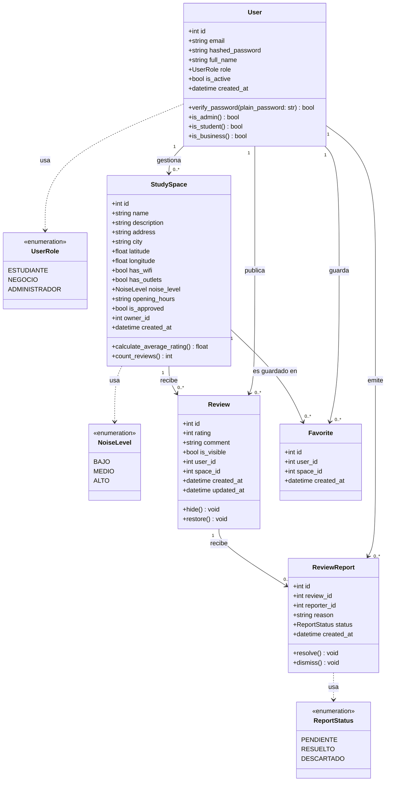

# Plataforma de Espacios de Estudio - API RESTful

Trabajo Práctico para la materia **Programación 2** (UNSAM).

---

## 📌 Descripción del Proyecto

API RESTful orientada a conectar estudiantes con espacios aptos para estudiar (cafeterías, bibliotecas, espacios de coworking), permitiéndoles buscar y filtrar lugares según sus preferencias (WiFi, enchufes, nivel de ruido), calificar y reseñar espacios, y guardar lugares en favoritos. Los establecimientos pueden vincularse para gestionar sus datos y los administradores moderan la plataforma.

---

## 🎯 Requerimientos de Alto Nivel (MVP)

1. **RQ1 - Gestión de Usuarios y Autenticación Segura (JWT + Roles):**
   * Registro y autenticación de usuarios con roles diferenciados: `Estudiante`, `Negocio` y `Administrador`.
   * Encriptación de contraseñas y autorización basada en roles mediante tokens Bearer JWT.

2. **RQ2 - Gestión de Espacios de Estudio (CRUD):**
   * Creación, edición, consulta y baja de espacios de estudio con sus atributos y características.

3. **RQ3 - Búsqueda y Filtrado de Espacios:**
   * Búsqueda por término/nombre y filtrado dinámico por disponibilidad de WiFi, enchufes y nivel de ruido.

4. **RQ4 - Calificaciones y Reseñas:**
   * Publicación, edición y eliminación de calificaciones (1 a 5) y comentarios por parte de estudiantes.
   * Cálculo automático de la valoración promedio de cada espacio.

5. **RQ5 - Espacios Favoritos:**
   * Los estudiantes pueden guardar y consultar su lista personalizada de espacios favoritos.

6. **RQ6 - Moderación de Contenido:**
   * Reporte de reseñas y moderación por parte de administradores (ocultar o dar de baja contenido inapropiado).

---

## 📐 Diagrama de Clases UML



---

## 🏗️ Arquitectura y Patrones de Diseño

El proyecto implementa una arquitectura en capas desacopladas aplicando el **Patrón Repositorio (Repository Pattern)** junto con una **Capa de Servicios (Service Layer)**:

* **Routers (Controladores):** Manejan las peticiones HTTP, validación de entrada/salida mediante schemas de Pydantic y códigos de respuesta HTTP.
* **Services:** Contienen la lógica del negocio (reglas de cálculo de calificaciones, validaciones cruzadas, restricciones por rol).
* **Repositories:** Encapsulan y abstraen las operaciones sobre la base de datos mediante SQLAlchemy, permitiendo testear la lógica de negocio de manera aislada (mediante *mocks*) sin acoplarse al motor de persistencia.

---

## 🚀 Instalación y Puesta en Marcha

### Prerrequisitos
* Python 3.11+
* Git

### 1. Clonar el repositorio y crear entorno virtual
```bash
git clone <URL_DEL_REPOSITORIO>
cd study-spaces-rest-api

# Crear entorno virtual
python -m venv venv

# Activar entorno virtual
# En Windows (PowerShell):
.\venv\Scripts\Activate.ps1
# En Linux/macOS:
source venv/bin/activate
```

### 2. Instalar dependencias
```bash
pip install -r requirements.txt
```

### 3. Ejecutar la API en modo desarrollo
```bash
uvicorn app.main:app --reload
```

La documentación interactiva OpenAPI (Swagger) estará disponible en:
* [http://localhost:8000/docs](http://localhost:8000/docs)
* [http://localhost:8000/redoc](http://localhost:8000/redoc)

---

## 🧪 Ejecución de Pruebas (Testing)

```bash
pytest -v
```

---

## 👥 Integrantes y Docentes
* **Docentes evaluadores:** `matuk`, `santiagoblaslaguzza`
