# Plataforma de Espacios de Estudio - API RESTful

Trabajo Práctico para la materia **Programación 2** (UNSAM).

---

## Descripción del Proyecto

API RESTful orientada a conectar estudiantes con espacios aptos para estudiar (cafeterías, bibliotecas, espacios de coworking), permitiéndoles buscar y filtrar lugares según sus preferencias (WiFi, enchufes, nivel de ruido), calificar y reseñar espacios, y guardar lugares en favoritos. Los establecimientos pueden vincularse para gestionar sus datos y los administradores moderan la plataforma.

---

## Requerimientos de Alto Nivel (MVP)

1. **RQ1 - Gestión de Usuarios y Autenticación Segura (JWT + Roles):**
   * Registro y autenticación de usuarios con roles diferenciados: `Estudiante`, `Negocio` y `Administrador`.
   * Encriptación de contraseñas y autorización basada en roles mediante tokens Bearer JWT.

2. **RQ2 - Gestión de Espacios de Estudio (CRUD):**
   * Creación, edición, consulta y baja de espacios de estudio con sus atributos y características.

3. **RQ3 - Búsqueda y Filtrado de Espacios:**
   * Búsqueda por término/nombre y filtrado dinámico por disponibilidad de WiFi, enchufes y nivel de ruido.

4. **RQ4 - Calificaciones y Reseñas:**
   * Publicación, edición y eliminación de calificaciones (1 a 5) y comentarios por parte de estudiantes.
   * Cálculo automático de la valoración promedio de cada espacio.

5. **RQ5 - Espacios Favoritos:**
   * Los estudiantes pueden guardar y consultar su lista personalizada de espacios favoritos.

6. **RQ6 - Moderación de Contenido:**
   * Reporte de reseñas y moderación por parte de administradores (ocultar o dar de baja contenido inapropiado).

---

## Diagrama de Clases UML

```mermaid
%%{init: {'class': {'hideEmptyMembersBox': true, 'padding': 5, 'nodeSpacing': 15, 'rankSpacing': 25, 'diagramPadding': 8}, 'flowchart': {'nodeSpacing': 15, 'rankSpacing': 25}, 'themeVariables': {'fontSize': '15px'}, 'themeCSS': '.node rect, .node path, .node polygon { stroke-width: 1.2px !important; } .label { line-height: 1.15 !important; }'}}%%
classDiagram
    direction LR

    class User {
        <<abstract>>
        +id : Integer
        +email : String
        +hashed_password : String
        +full_name : String
        +is_active : Bool
        +created_at : Datetime
        +notification_preferences : List~NotificationPreference~
        +verify_password(plain_password : String) Bool
        +verify_email() Bool
        +receive_notification() Void
        +change_notification_preference(notification : NotificationPreference, change : Bool) Void
    }

    class StudentUser {
        +lists : List~StudySpacesList~
        +write_review(space : StudySpace, comment : String) Review
        +create_list() StudySpacesList
        +add_to_list(space : StudySpace, list : StudySpacesList) Void
        +add_to_favorite(space : StudySpace) Void
        +notify_promotion() Void
    }

    class BusinessUser {
        +list_owned_spaces : List~StudySpace~
        +campaigns : List~Campaign~
        +has_active_campaign() Bool
        +write_post(space : StudySpace) Post
        +delete_post(post : Post) Void
        +edit_post(post : Post, new_title : String, new_content : String) Void
    }

    class AdminUser {
        +resolve_report() Void
        +dismiss_report() Void
    }

    class StudySpace {
        +id : Integer
        +name : String
        +description : String
        +address : String
        +city : String
        +latitude : Float
        +longitude : Float
        +has_wifi : Bool
        +has_outlets : Bool
        +noise_level : NoiseLevel
        +opening_hours : String
        +is_approved : Bool
        +created_at : Datetime
        +observers : List~StudentUser~
        +calculate_average_rating() Float
        +count_reviews() Integer
        +count_favorites() Integer
        +has_owner() Bool
        +register_observer(student : StudentUser) Void
        +remove_observer(student : StudentUser) Void
        +notify_observers() Void
    }

    class NoiseLevel {
        <<enumeration>>
        BAJO
        MEDIO
        ALTO
    }

    class Review {
        +id : Integer
        +rating : Integer
        +comment : String
        +images : List~String~
        +is_visible : Bool
        +created_at : Datetime
        +updated_at : Datetime
        +hide() Void
        +restore() Void
    }

    class ReviewVote {
        +id : Integer
        +is_useful : Bool
        +created_at : Datetime
    }

    class Post {
        +id : Integer
        +title : String
        +content : String
        +images : List~String~
        +is_active : Bool
        +hide() Void
        +restore() Void
    }

    class StudySpacesList {
        +id : Integer
        +name : String
        +created_at : Datetime
        +list_spaces : List~StudySpace~
        +save_space(space : StudySpace) Void
        +remove_space(space : StudySpace) Void
    }

    class FavoritesList {
        +save_space(space : StudySpace) Void
        +remove_space(space : StudySpace) Void
    }

    class Report {
        <<abstract>>
        +id : Integer
        +reason : String
        +status : ReportStatus
        +created_at : Datetime
        +resolve() Void
        +dismiss() Void
        -notify_observers(new_status : ReportStatus) Void
    }

    class ReviewReport {
        -notify_observers(new_status : ReportStatus) Void
    }

    class StudySpaceReport {
        -notify_observers(new_status : ReportStatus) Void
    }

    class UserReport {
        -notify_observers(new_status : ReportStatus) Void
    }

    class PostReport {
        -notify_observers(new_status : ReportStatus) Void
    }

    class ReportStatus {
        <<enumeration>>
        PENDIENTE
        RESUELTO
        DESCARTADO
    }

    class OwnershipRequest {
        +id : Integer
        +status : OwnershipRequestStatus
        +created_at : Datetime
        +resolved_at : Datetime
        +approve() Void
        +reject() Void
        -notify_user() Void
    }

    class OwnershipRequestStatus {
        <<enumeration>>
        PENDIENTE
        APROBADA
        RECHAZADA
    }

    class NotificationPreference {
        +event_type : String
        +channel : String
        +is_enabled : Bool
    }

    class NotificationService {
        <<abstract>>
        +create_notifications(user : User, message : String) List~Notification~
        +send_notifications(user : User, message : String) Void
    }

    class ModerationNotificationService {
        +create_notifications(user : User, message : String) List~Notification~
    }

    class PromotionNotificationService {
        +create_notifications(user : User, message : String) List~Notification~
    }

    class Notification {
        <<abstract>>
        +send() Void
    }

    class EmailNotification {
        +send() Void
    }

    class InAppNotification {
        +send() Void
    }

    class AdvertisingPlan {
        +id : Integer
        +name : String
        +description : String
        +price : Decimal
        +duration_days : Integer
        +is_active : Bool
    }

    class Campaign {
        +id : Integer
        +status : CampaignStatus
        +start_date : Date
        +end_date : Date
        +created_at : Datetime
        +activate() Void
        +cancel() Void
    }

    class CampaignStatus {
        <<enumeration>>
        PENDIENTE
        ACTIVA
        FINALIZADA
        CANCELADA
    }

    class Payment {
        +id : Integer
        +amount : Decimal
        +status : PaymentStatus
        +created_at : Datetime
        +external_payment_id : String
        +approve() Void
        +reject() Void
    }

    class PaymentStatus {
        <<enumeration>>
        PENDIENTE
        APROBADO
        RECHAZADO
        CANCELADO
    }

    class MercadoPagoService {
        +create_checkout(campaign : Campaign) String
        +verify_payment(external_id : String) PaymentStatus
        +process_notification(payload : String) Void
    }

    User <|-- StudentUser
    User <|-- BusinessUser
    User <|-- AdminUser
    User "1" --> "0..*" Report : emite
    User "1" --> "0..*" UserReport : recibe
    User "1" --> "0..*" NotificationPreference : gestiona
    User "1" --> "0..*" Notification : recibe

    StudentUser "1" --> "0..*" Review : publica
    StudentUser "1" --> "0..*" StudySpacesList : guarda
    StudentUser "1" --> "0..*" ReviewVote: emite

    BusinessUser "0..1" --> "0..*" StudySpace : gestiona
    BusinessUser "1" --> "0..*" Post : publica
    BusinessUser "1" --> "0..*" OwnershipRequest : emite
    BusinessUser "1" --> "0..*" Campaign : contrata

    AdminUser "0..1" --> "0..*" Report : gestiona
    AdminUser "0..1" --> "0..*" OwnershipRequest : gestiona
    AdminUser "0..1" --> "0..*" Campaign : gestiona

    StudySpace "1" --> "0..*" Review : recibe
    StudySpace "1" --> "0..*" Post : recibe
    StudySpace "1" --> "0..*" StudySpacesList : es guardado en
    StudySpace "1" --> "0..*" StudySpaceReport : recibe
    StudySpace "1" --> "0..*" OwnershipRequest : recibe
    StudySpace "1" --> "0..*" Campaign : es promocionado por
    StudySpace ..> NoiseLevel : usa
    StudySpace ..> PromotionNotificationService : usa

    StudySpacesList <|-- FavoritesList

    Review "1" --> "0..*" ReviewReport : recibe
    Review "1" --> "0..*" ReviewVote : recibe

    Post "1" --> "0..*" PostReport : recibe

    Report <|-- ReviewReport
    Report <|-- StudySpaceReport
    Report <|-- UserReport
    Report <|-- PostReport
    Report ..> ModerationNotificationService : usa
    ReviewReport ..> ReportStatus : usa

    OwnershipRequest ..> OwnershipRequestStatus : usa

    NotificationPreference ..> NotificationService

    NotificationService <|-- ModerationNotificationService
    NotificationService <|-- PromotionNotificationService
    NotificationService ..> Notification

    Notification <|-- EmailNotification
    Notification <|-- InAppNotification

    ModerationNotificationService ..> EmailNotification : crea
    ModerationNotificationService ..> InAppNotification : crea
    PromotionNotificationService ..> EmailNotification : crea
    PromotionNotificationService ..> InAppNotification : crea

    AdvertisingPlan "1" --> "0..*" Campaign : corresponde a

    Campaign "1" --> "0..*" Payment : registra
    Campaign ..> CampaignStatus : usa

    Payment ..> PaymentStatus : usa

    MercadoPagoService ..> Payment
    MercadoPagoService ..> Campaign
```

[](https://mermaid.live/view#pako:eNrFGmtv2zjyr-gMFHGvSXBdoMDBWxRwEheXRZoYcdsPRQCBkSY2txKpJamk3lz6229IPUyKlGxn29t8CEzOg_OeIe3HUcJTGE1GL148UkbVJHo8SDIi5YH-tKIpzPJCrT9AfgtCnvBvuK9ECYfRQUHSlLIlbrzBFUM2i4Ik1c5rvSUI-7rZ-kVvpZQsBcnnLem_n3D3LuMPyYoIZQ7dgZMmUivI4TMRlNxmUIl7x5la0D8BFwev3xTfDlq808VCbx5r3pGARB1G1eeCqFX7mWfrJWfRYySV4F_h6IGmaoUiHP9SfIv-QfOCC0WY-jV6io4zcgsZomaUwdEK6HKlNObrNy7iwdPTixc3zJj0rFL-hkX4l1ItBsXjLq5vWLVnsKJPEkT0WO3ov7dvyS0KRBL17t1m9xVNo0l0zhQsQVjbkBOaIWShBFrLAqyIXEEaF3jEAxdpCOWuzLKYkRxCQCpjFIHea-AJ55kFSgQQhbyJQtgZflQ0BwvOuKJ3NCFa3bgQcAcCWAISsS-oVN8vLfi8BX-3ONyDoHfrVvhxkRHKfF1ediWr6YxRxh4UPQCoUGzLh1ifOU1t7VaELV0kS4mxvY-ChHU5jCoute3sM55c7y9UmQJT3SB4laGhWoNppLVOCJBmbeE9CKogFnBP4WEsNYqxToOPgvA8xwMsm10bZM-fsT4SzdE5zMLDLI4Vr_BCR2mAs2UYeAau2dyRe66FD7DySIzRMR4Ez7nntY5FT0qJOSpl0KQxf2AYuebIgHltyyYkLwhdshbttN747mZZnSZxg-_HXeWjggfN9jKac8fKKWTQoOt_iK0xPJtASpWHdRgxeIgVVdkmqau9BIulGwe9FpymOWWe-QRInt3rWNPlzs-blMqcShmCB2K-Ut45oKfC9RWoFGQiaFHnoQfGKEOJZQiUULUO7WeYxTodEfY-48R2SsbZsg-mY-ABi4BfKDWEl-gLk8odIONUYtLBPWSmjuDqQi8sFF4AQxHjFS-F7CvSBWbFPaT7l2l-iy7GiunkQV2L3ETIkjLTFYIgNsHaKNBQbIku7poi4SVTdTWSCPe9WWE0uR_GMWbDPBWhEr5ESUHEjfBjWQld51QtvhecAnI00r5UddlpDTUU1BsHus0cWJmDMP3B7ucn09-uNqsPs7Nzazm9-HgVPKQq3btkTeWiIKjbEWxmObrXigcN_u7G2z2V9DZ7xlRQFukgXA-f44DjpOIChixfGeUzVzuVE1ShlICjz14adI7UpXaXw9xC7PjArcb7-aBvMHu2CTst-6-U5W1hYLrwLv1XYrWpEHeZEOoE3wW_o_v7phZ5mv-_JLg2HfP5dwC0uAw3QamIKrWdqyMWZrmHs-qe39vsPcCRVzL17BEUY2tG-2b5Mdw3PvlZJ-hm8rN469Lzs3jbaDt1sfns8ux8dvlxttm6ni0-zdr-pf_OZovT6fXH6Vm4p13pTi9XtLiGP0rYrfi0inWJnxvh_Qj1fBUqq7_jjb43A7DJiKGSG5b8uVafzq-vTqZnU9sPp_-Zfmm3vGkldG11TI-jDE5qal2EyzzebxlkPUMpMP1K486kAxIsMGape3xPBayvqvYlXI61qfEonXWHUY5DP1mCdc_x3hycLgMs3Y9dr0c_8LR21hbdfqgW3fLQXJH_RhlsjB18ql0wlCkz_ZrTx3Mr9TmbFsWzqacpFlOFIy9bzjPCfuJ9tRDUTAxnkOAEaE91aVlFVZySteybaQMjYUeV5vlir_raEHl1FTGEivVEX5dNu3JgSoUh26qx0QK3A69yBOtTNuQqV9RnF9LTj-efrTL6_vxyenH-xSmtp9PL09lFX2mdk7W5Xu1gZpLr23DQ6a0HanZ7Nzb4htdkRrK4qBjENPgGvE97Cyv6QxrXld-4rnyDhweIDyASkvI5WfKBQpesIPnKSzVu3ums6H7p26V9gTY6jltrUvv1uc83aFK83kj3oRlZZZykw53EvLq9_e_Rkf0u0QXZL5xdWPt2ZwFuRq9vRtHR0Tv89K_j43_iop4gJxHktMnQPlxrmp3oL1Po7RaCnuFiEuG9Vu-R3cmtEysi-708qJd5IJlERXmbIY-diLq3XxS0JCIle5yoXx9aY1Z0zju0QR842DNOh9ojnVdvvo6a22i8Sdtx_zbq003e6NcLzG7SqLp5MA7r2UaPq-M2soC8-zGwRN4Qbrxam34ojOxwHyapHbI7gR91IOvAS3kEbD8ewQQdJg6Yd3diy7QotvliJtH2RdFREI_D8fE7-4V0EpWSBJEG59earEtY2c-UP-cxp8Gsvdnr56DtthGZ98ZudTJB0BMc3inNOWbbSG-L40O7zvYxNpXah21EcGDa5sMXF8tXjrk0pfNg4HjHCy6N3nPndQh7mkcVQJ50IapGcKP2oG5baIdisZ-0K2lIxIq_d7HpQ_TuMA3PYc9pSfzLE5ZvnIh2pfevTzb9YLZuP34ref_pTQNwr2fb2pYQIAvOUohaFi08lLb1KK9zVn_vJEiHRsvYuXc4wdwwMJXNGZcdtMAEa1EM4jSnjw5HOHGjtdPRZPR4MzI_g7kZTVCZFO5Imamb0RMikVLxxZolo4n5Wc-o-lam_qlKs1kQ9oXzevn0P2HjZvw)



---

## Arquitectura y Patrones de Diseño

El proyecto implementa una arquitectura en capas desacopladas aplicando el **Patrón Repositorio (Repository Pattern)** junto con una **Capa de Servicios (Service Layer)**:

* **Routers (Controladores):** Manejan las peticiones HTTP, validación de entrada/salida mediante schemas de Pydantic y códigos de respuesta HTTP.
* **Services:** Contienen la lógica del negocio (reglas de cálculo de calificaciones, validaciones cruzadas, restricciones por rol).
* **Repositories:** Encapsulan y abstraen las operaciones sobre la base de datos mediante SQLAlchemy, permitiendo testear la lógica de negocio de manera aislada (mediante *mocks*) sin acoplarse al motor de persistencia.

El proyecto también implementa el **Patrón Observer** y el **Patrón Factory Method** para gestionar la arquitectura del servicio de notificaciones:

* **Observer:** Permite reaccionar ante eventos y cambio de estados (como una promoción en una StudySpace o la resolución de un Report) sin acoplar directamente al objeto observado con todos los componentes que deben recibir la alerta. El objeto emisor del evento simplemente notifica a sus obesrvadores registrados (User).
* **Factory Method:** Permite delegar la creación de las notificaciones (NotificationService) a subclases especializadas (como ModerationNotificationService). De esta forma, cada servicio decide dinámicamente qué canales instanciar (EmailNotification, InAppNotification o ambas), según el tipo de evento y las preferencias configuradas por el usuario, sin que el objeto que dispara el evento necesite conocer las clases concretas que se terminan creando.

---

## Instalación y Puesta en Marcha

### Prerrequisitos
* Python 3.11+
* Git

### 1. Clonar el repositorio y crear entorno virtual
```bash
git clone <URL_DEL_REPOSITORIO>
cd study-spaces-rest-api

# Crear entorno virtual
python -m venv venv

# Activar entorno virtual
# En Windows (PowerShell):
.\venv\Scripts\Activate.ps1
# En Linux/macOS:
source venv/bin/activate
```

### 2. Instalar dependencias
```bash
pip install -r requirements.txt
```

### 3. Ejecutar la API en modo desarrollo
```bash
uvicorn app.main:app --reload
```

La documentación interactiva OpenAPI (Swagger) estará disponible en:
* [http://localhost:8000/docs](http://localhost:8000/docs)
* [http://localhost:8000/redoc](http://localhost:8000/redoc)

---

## Ejecución de Pruebas (Testing)

```bash
pytest -v
```

---

## Integrantes y Docentes
* **Docentes evaluadores:** `matuk`, `santiagoblaslaguzza`
