# Plataforma de Espacios de Estudio - API RESTful

Trabajo Práctico para la materia **Programación 2** (UNSAM).

---

## Descripción del Proyecto

API RESTful orientada a conectar estudiantes con espacios aptos para estudiar (cafeterías, bibliotecas, espacios de coworking), permitiéndoles buscar y filtrar lugares según sus preferencias (WiFi, enchufes, nivel de ruido), calificar y reseñar espacios, y guardar lugares en favoritos. Los establecimientos pueden vincularse para gestionar sus datos y los administradores moderan la plataforma.

---

## Requerimientos de Alto Nivel (MVP)

1. **RQ1 - Gestión de Usuarios y Autenticación Segura (JWT + Roles):**
   * Registro y autenticación de usuarios con roles diferenciados: `Estudiante`, `Negocio` y `Administrador`.
   * Encriptación de contraseñas y autorización basada en roles mediante tokens Bearer JWT.

2. **RQ2 - Gestión de Espacios de Estudio:**
   * Creación, edición, consulta de espacios propios (`/spaces/mine`) y flujo de moderación por administradores (pendientes, aprobación y rechazo).

3. **RQ3 - Búsqueda y Filtrado de Espacios:**
   * Búsqueda por término/nombre y filtrado dinámico por disponibilidad de WiFi, enchufes y nivel de ruido.

4. **RQ4 - Calificaciones y Reseñas:**
   * Publicación, edición y eliminación de calificaciones (1 a 5) y comentarios por parte de estudiantes.
   * Cálculo automático de la valoración promedio de cada espacio.

5. **RQ5 - Espacios Favoritos:**
   * Los estudiantes pueden guardar y consultar su lista personalizada de espacios favoritos.

6. **RQ6 - Moderación de Contenido:**
   * Reporte de reseñas y moderación por parte de administradores (ocultar o dar de baja contenido inapropiado).

### Funcionalidades Adicionales Implementadas
* **Publicaciones de Negocios (`/posts`):** Creación, edición y baja de novedades e imágenes asociadas a un espacio de estudio.
* **Notificaciones (`/notifications`):** Bandeja de notificaciones in-app y preferencias de notificación por usuario.

---

## Casos de Uso

| Caso de Uso | Actor | Descripción y Endpoints asociados |
| :--- | :--- | :--- |
| **CU1 - Registro e inicio de sesión** | Estudiante / Negocio / Admin | Registro diferenciado (`POST /users/register/student`, `POST /users/register/business`), login con JWT (`POST /users/login`) y consulta de perfil (`GET /users/me`). |
| **CU2 - Buscar y filtrar espacios** | Público / Estudiante | Listado de espacios aprobados con filtros por nombre, WiFi, enchufes y nivel de ruido (`GET /spaces/`). |
| **CU3 - Publicar y gestionar espacios** | Negocio | Alta de un espacio en estado pendiente (`POST /spaces/`), consulta de espacios propios (`GET /spaces/mine`) y edición con reenvío a revisión (`PUT /spaces/{space_id}`). |
| **CU4 - Aprobar o rechazar espacios** | Administrador | Revisión de espacios pendientes (`GET /spaces/pending`), aprobación (`PATCH /spaces/{space_id}/approve`) o rechazo (`PATCH /spaces/{space_id}/reject`). |
| **CU5 - Reseñar y votar reseñas** | Estudiante | Publicación (`POST /reviews/space/{space_id}`), edición (`PUT /reviews/{review_id}`), baja (`DELETE /reviews/{review_id}`) y voto de utilidad (`PUT /reviews/{review_id}/vote`). |
| **CU6 - Gestionar listas y favoritos** | Estudiante | Creación/gestión de listas personalizadas (`/lists`) y guardado en favoritos (`/favorites`), que suscribe al usuario a novedades del espacio. |
| **CU7 - Publicar novedades** | Negocio | Creación, edición y eliminación de publicaciones en espacios propios (`/posts/space/{space_id}`, `/posts/{post_id}`). |
| **CU8 - Reportar y moderar contenido** | Usuario / Administrador | Reporte de reseñas, posts, espacios o usuarios (`POST /reports/...`) y resolución o descarte por administradores (`PUT /reports/{report_id}/resolve`, `PUT /reports/{report_id}/dismiss`). |
| **CU9 - Consultar notificaciones** | Usuario autenticado | Consulta de bandeja (`GET /notifications`), contador de no leídas (`GET /notifications/unread-count`), marcado como leída y configuración de preferencias (`PUT /notifications/preferences`). |

---

## Diagrama de Clases UML

```mermaid
%%{init: {'class': {'hideEmptyMembersBox': true, 'padding': 5, 'nodeSpacing': 15, 'rankSpacing': 25, 'diagramPadding': 8}, 'flowchart': {'nodeSpacing': 15, 'rankSpacing': 25}, 'themeVariables': {'fontSize': '15px'}, 'themeCSS': '.node rect, .node path, .node polygon { stroke-width: 1.2px !important; } .label { line-height: 1.15 !important; }'}}%%
classDiagram
    direction TB

    class User {
        <<abstract>>
        +id : Integer
        +email : String
        +hashed_password : String
        +full_name : String
        +is_active : Bool
        +created_at : Datetime
        +notification_preferences : List~NotificationPreference~
        +verify_password(plain_password : String) Bool
        +verify_email() Bool
        +receive_notification() Void
        +change_notification_preference(notification : NotificationPreference, change : Bool) Void
    }

    class StudentUser {
        +lists : List~StudySpacesList~
        +write_review(space : StudySpace, comment : String) Review
        +create_list() StudySpacesList
        +add_to_list(space : StudySpace, list : StudySpacesList) Void
        +add_to_favorite(space : StudySpace) Void
        +notify_promotion() Void
    }

    class BusinessUser {
        +list_owned_spaces : List~StudySpace~
        +campaigns : List~Campaign~
        +has_active_campaign() Bool
        +write_post(space : StudySpace) Post
        +delete_post(post : Post) Void
        +edit_post(post : Post, new_title : String, new_content : String) Void
    }

    class AdminUser {
        +resolve_report() Void
        +dismiss_report() Void
    }

    class StudySpace {
        +id : Integer
        +name : String
        +description : String
        +address : String
        +city : String
        +latitude : Float
        +longitude : Float
        +has_wifi : Bool
        +has_outlets : Bool
        +noise_level : NoiseLevel
        +opening_hours : String
        +is_approved : Bool
        +created_at : Datetime
        +observers : List~StudentUser~
        +calculate_average_rating() Float
        +count_reviews() Integer
        +count_favorites() Integer
        +has_owner() Bool
        +register_observer(student : StudentUser) Void
        +remove_observer(student : StudentUser) Void
        +notify_observers() Void
    }

    class NoiseLevel {
        <<enumeration>>
        BAJO
        MEDIO
        ALTO
    }

    class Review {
        +id : Integer
        +rating : Integer
        +comment : String
        +images : List~String~
        +is_visible : Bool
        +created_at : Datetime
        +updated_at : Datetime
        +hide() Void
        +restore() Void
    }

    class ReviewVote {
        +id : Integer
        +is_useful : Bool
        +created_at : Datetime
    }

    class Post {
        +id : Integer
        +title : String
        +content : String
        +images : List~String~
        +is_active : Bool
        +hide() Void
        +restore() Void
    }

    class StudySpacesList {
        +id : Integer
        +name : String
        +created_at : Datetime
        +list_spaces : List~StudySpace~
        +save_space(space : StudySpace) Void
        +remove_space(space : StudySpace) Void
    }

    class FavoritesList {
        +save_space(space : StudySpace) Void
        +remove_space(space : StudySpace) Void
    }

    class Report {
        <<abstract>>
        +id : Integer
        +reason : String
        +status : ReportStatus
        +created_at : Datetime
        +resolve() Void
        +dismiss() Void
        -notify_observers(new_status : ReportStatus) Void
    }

    class ReviewReport {
        -notify_observers(new_status : ReportStatus) Void
    }

    class StudySpaceReport {
        -notify_observers(new_status : ReportStatus) Void
    }

    class UserReport {
        -notify_observers(new_status : ReportStatus) Void
    }

    class PostReport {
        -notify_observers(new_status : ReportStatus) Void
    }

    class ReportStatus {
        <<enumeration>>
        PENDIENTE
        RESUELTO
        DESCARTADO
    }

    class OwnershipRequest {
        +id : Integer
        +status : OwnershipRequestStatus
        +created_at : Datetime
        +resolved_at : Datetime
        +approve() Void
        +reject() Void
        -notify_user() Void
    }

    class OwnershipRequestStatus {
        <<enumeration>>
        PENDIENTE
        APROBADA
        RECHAZADA
    }

    class NotificationPreference {
        +event_type : String
        +channel : String
        +is_enabled : Bool
    }

    class NotificationService {
        <<abstract>>
        +create_notifications(user : User, message : String) List~Notification~
        +send_notifications(user : User, message : String) Void
    }

    class ModerationNotificationService {
        +create_notifications(user : User, message : String) List~Notification~
    }

    class PromotionNotificationService {
        +create_notifications(user : User, message : String) List~Notification~
    }

    class Notification {
        <<abstract>>
        +send() Void
    }

    class EmailNotification {
        +send() Void
    }

    class InAppNotification {
        +send() Void
    }

    class AdvertisingPlan {
        +id : Integer
        +name : String
        +description : String
        +price : Decimal
        +duration_days : Integer
        +is_active : Bool
    }

    class Campaign {
        +id : Integer
        +status : CampaignStatus
        +start_date : Date
        +end_date : Date
        +created_at : Datetime
        +activate() Void
        +cancel() Void
    }

    class CampaignStatus {
        <<enumeration>>
        PENDIENTE
        ACTIVA
        FINALIZADA
        CANCELADA
    }

    class Payment {
        +id : Integer
        +amount : Decimal
        +status : PaymentStatus
        +created_at : Datetime
        +external_payment_id : String
        +approve() Void
        +reject() Void
    }

    class PaymentStatus {
        <<enumeration>>
        PENDIENTE
        APROBADO
        RECHAZADO
        CANCELADO
    }

    class MercadoPagoService {
        +create_checkout(campaign : Campaign) String
        +verify_payment(external_id : String) PaymentStatus
        +process_notification(payload : String) Void
    }

    User <|-- StudentUser
    User <|-- BusinessUser
    User <|-- AdminUser
    User "1" --> "0..*" Report : emite
    User "1" --> "0..*" UserReport : recibe
    User "1" --> "0..*" NotificationPreference : gestiona
    User "1" --> "0..*" Notification : recibe

    StudentUser "1" --> "0..*" Review : publica
    StudentUser "1" --> "0..*" StudySpacesList : guarda
    StudentUser "1" --> "0..*" ReviewVote: emite

    BusinessUser "0..1" --> "0..*" StudySpace : gestiona
    BusinessUser "1" --> "0..*" Post : publica
    BusinessUser "1" --> "0..*" OwnershipRequest : emite
    BusinessUser "1" --> "0..*" Campaign : contrata

    AdminUser "0..1" --> "0..*" Report : gestiona
    AdminUser "0..1" --> "0..*" OwnershipRequest : gestiona
    AdminUser "0..1" --> "0..*" Campaign : gestiona

    StudySpace "1" --> "0..*" Review : recibe
    StudySpace "1" --> "0..*" Post : recibe
    StudySpace "1" --> "0..*" StudySpacesList : es guardado en
    StudySpace "1" --> "0..*" StudySpaceReport : recibe
    StudySpace "1" --> "0..*" OwnershipRequest : recibe
    StudySpace "1" --> "0..*" Campaign : es promocionado por
    StudySpace ..> NoiseLevel : usa
    StudySpace ..> PromotionNotificationService : usa

    StudySpacesList <|-- FavoritesList

    Review "1" --> "0..*" ReviewReport : recibe
    Review "1" --> "0..*" ReviewVote : recibe

    Post "1" --> "0..*" PostReport : recibe

    Report <|-- ReviewReport
    Report <|-- StudySpaceReport
    Report <|-- UserReport
    Report <|-- PostReport
    Report ..> ModerationNotificationService : usa
    ReviewReport ..> ReportStatus : usa

    OwnershipRequest ..> OwnershipRequestStatus : usa

    NotificationPreference ..> NotificationService

    NotificationService <|-- ModerationNotificationService
    NotificationService <|-- PromotionNotificationService
    NotificationService ..> Notification

    Notification <|-- EmailNotification
    Notification <|-- InAppNotification

    ModerationNotificationService ..> EmailNotification : crea
    ModerationNotificationService ..> InAppNotification : crea
    PromotionNotificationService ..> EmailNotification : crea
    PromotionNotificationService ..> InAppNotification : crea

    AdvertisingPlan "1" --> "0..*" Campaign : corresponde a

    Campaign "1" --> "0..*" Payment : registra
    Campaign ..> CampaignStatus : usa

    Payment ..> PaymentStatus : usa

    MercadoPagoService ..> Payment
    MercadoPagoService ..> Campaign
```

<a href="https://mermaid.live/view#pako:eNrFGmtv2zjyr-gMFHFvk2C7QIGFtyjgJC42hzQx4mw_FAEERprYvEqkjqSSerPpb78h9TApUrKdbe_yITA5D857hrSfRglPYTQZvXr1RBlVk-jpIMmIlAf604qmMMsLtf4I-R0IecK_4r4SJRxGBwVJU8qWuPEWVwzZLAqSVDtv9JYg7Mtm6xe9lVKyFCSft6S_PuPufcYfkxURyhy6AydNpFaQwyciKLnLoBL3njO1oH8CLg7evC2-HrR4p4uF3jzWvCMBiTqMqs8FUav2M8_WS86ip0gqwb_A0SNN1QpFOP6l-Br9g-YFF4ow9Vv0HB1n5A4yRM0og6MV0OVKacw3b13Eg-fnV69umTHpWaX8LYvwL6VaDIrH3ZzcsmrPYEV_SBDRU7Wj_969I3coEEnU-_eb3Z9oGk2ic6ZgCcLahpzQDCELJdBaFmBF5ArSuMAjHrlIQyj3ZZbFjOQQAlIZowj0QQNPOM8sUCKAKORNFMLO8KOiOVhwxhW9pwnR6saFgHsQwBKQiH1Bpfp2acHnLfibxeEBBL1ft8KPi4xQ5uvyuitZTWeMMvag6AFAhWJbPsT6xGlqa7cibOkiWUqM7X0UJKzLYVRxqW1nn_Hsen-hyhSY6gbBTxkaqjWYRlrrhABp1hbeo6AKYgEPFB7HUqMY6zT4KAjPczzAstm1Qfb8Gesj0Rydwyw8zOJY8QovdJQGOFuGgWfgms09eeBa-AArj8QYHeNB8Jx7XutY9KSUmKNSBk0a80eGkWuODJjXtmxC8oLQJWvRTuuNb26W1WkSN_h-3FU-KnjQbK-jOXesnEIGDbr-h9gaw7MJpFR5WIcRg8dYUZVtkrraS7BYunHQa8FpmlPmmU-A5NmDjjVd7vy8SanMqZQheCDmK-WdA3oqXF-BSkEmghZ1HnpgjDKUWIZACVXr0H6GWazTEWEfMk5sp2ScLftgOgYesQj4hVJDeIm-MKncATJOJSYdPEBm6giuLvTCQuEFMBQxXvFSyL4iXWBWPEC6f5nmd-hirJhOHtS1yE2ELCkzXSEIYhOsjQINxZbo4q4pEl4yVVcjiXDfmxVGk_thHGM2zFMRKuFLlBRE3Ag_lpXQdU7V4nvBKSBHI-1LVZed1lBDQb1xoNvMgZU5CNMf7H5-Mv3X1Wb1cXZ2bi2nFzdXwUOq0r1L1lQuCoK6HcFmlqN7rXjQ4G9uvD1QSe-yF0wFZZEOwvXwOQ44TiouYMjylVE-cbVTOUEVSgk4-uylQedIXWp3OcwtxI4P3Gq8nw_6BrMXm7DTsv9OWd4WBqYL79J_JVabCnGXCaFO8F3wO7p_aGqRp_n_SoJr0zFffgdAi8twE5SKqFLbuTpiYZZ7OKvu-b3N3gMceSVTzx5BMbZmtG-W78N945MfdYJuJj-Kty49P4q3jbZTF5vPLs_OZ5c3s83W9Wzxx6ztX_rvbLY4nV7fTM_CPe1Kd3q5osU1_KeE3YpPq1iX-KUR3o9Qz1ehsvpvvNH3ZgA2GTFUcsOSv9Tq0_n11cn0bGr74fT36ed2y5tWQtdWx_Q4yuCkptZFuMzj_ZZB1jOUAtOvNO5MOiDBAmOWusf3VMD6qmpfwuVYmxqP0ll3GOU49JMlWPcc783B6TLA0v3Y9Xr0I09rZ23R7btq0S0PzRX5_yiDjbGDT7ULhjJlpl9z-nhupT5n06J4MfU0xWKqcORly3lG2A-8rxaCmonhDBKcAO2pLi2rqIpTspZ9M21gJOyo0jxf7FVfGyKvriKGULGe6OuyaVcOTKkwZFs1NlrgduBVjmB9yoZc5Yr64kJ6enP-ySqjH84vpxfnn53Sejq9PJ1d9JXWOVmb69UOZia5vg0Hnd56oGa3d2ODr3hNZiSLi4pBTINvwPu0t7Ci36VxXfmN68o3eHiA-AgiISmfkyUfKHTJCpIvvFTj5p3Oiu7Xvl3aF2ij47i1JrVfn_t8gybF6410H5qRVcZJOtxJzKvbu7-Ojux3iS7IfuHswtq3OwtwO3pzO4qOjt7jp5-Pj_-Ji3qCnESQ0yZD-3CtaXaiv0yhd1sIeoaLSYT3Wr1Hdie3TqyI7PfyoF7mgWQSFeVdhjx2IureflHQkoiU7HGifn1ojVnROe_QBn3gYM84HWqPdF69-TpqbqPxJm3H_duoTzd5o18vMLtJo-rmwTisZxs9ro7byALy7sfAEnlDuPFqbfqhMLLDfZikdsjuBH7UgawDL-URsP14BBN0mDhg3t2JLdOi2OaLmUTbF0VHQTwOx8fv7RfSSVRKEkQanF9rsi5hZT9T_pzHnAaz9mavn4O220Zk3hu71ckEQU9weKc055htI70tjg_tOtvH2FRqH7YRwYFpmw9fXCxfOebSlM6DgeMdL7g0es-d1yHsaR5VAHnShagawY3ag7ptoR2KxX7SrqQhESv-3sWmD9G7wzQ8hz2nJfEvT1i-cSLald6_Ptn0g9m6_fit5P2nNw3AvZ5ta1tCgCw4SyFqWbTwUNrWo7zOWf29kyAdGi1j597hBHPDwFQ2Z1x20AITrEUxiNOcPjoc4cSN1k5Hk9HT7cj8DOZ2NEFlUrgnZaZuR8-IRErFF2uWjCbmZz2j6luZ-qcqzWZB2GfO6-XzfwFMXGb0" target="_blank" rel="noopener noreferrer">
  
</a>



---

## Arquitectura y Patrones de Diseño

El proyecto implementa una arquitectura en capas desacopladas aplicando el **Patrón Repositorio (Repository Pattern)** junto con una **Capa de Servicios (Service Layer)**:

* **Routers (Controladores):** Manejan las peticiones HTTP, validación de entrada/salida mediante schemas de Pydantic y códigos de respuesta HTTP (`app/routers/`).
* **Services:** Contienen la lógica del negocio (reglas de cálculo de calificaciones, validaciones cruzadas, restricciones por rol) (`app/services/`).
* **Repositories:** Encapsulan y abstraen las operaciones sobre la base de datos mediante SQLAlchemy, desacoplando la lógica de negocio del motor de persistencia (`app/repositories/`).

Además, el dominio y el sistema de notificaciones aplican los siguientes patrones de diseño:

* **Template Method:**
  * En `Report` (`app/models/report.py`), `resolve()` y `dismiss()` fijan el flujo común de cierre (aplicar medida, actualizar estado, registrar `resolved_at` y notificar) delegando `_apply_resolution()` y `_notify_observers()` a cada subclase (`ReviewReport`, `PostReport`, `StudySpaceReport`, `UserReport`).
  * En `NotificationService` (`app/services/notification_service.py`), `send_notifications()` y `broadcast()` orquestan el flujo común (crear según preferencias, entregar vía `send()`, persistir) con `create_notifications()` como punto de extensión.
* **Observer:** `StudySpace` (`app/models/study_space.py`) expone `observers` (estudiantes que guardaron el espacio en `FavoritesList`) y `notify_observers()`, que notifica automáticamente ante novedades (`/posts`) o actualizaciones aprobadas del espacio.
* **Polimorfismo / Single-Table Inheritance (STI) y Registro de Canales:** `User`, `StudySpacesList`, `Report` y `Notification` se mapean en SQLAlchemy mediante herencia de tabla única. `NOTIFICATION_CLASSES` permite registrar nuevos canales (por ejemplo `EmailNotification`) sin modificar los servicios de negocio.

> **Nota sobre el diagrama UML:** Las clases `User` (`StudentUser`, `BusinessUser`, `AdminUser`), `StudySpace`, `Review`, `ReviewVote`, `Post`, `StudySpacesList`, `FavoritesList`, `Report` (y sus 4 subclases), `Notification` (`InAppNotification`), `NotificationPreference` y `NotificationService` (`ModerationNotificationService`, `PromotionNotificationService`) están implementadas en el código actual. Las clases `OwnershipRequest`, `AdvertisingPlan`, `Campaign`, `Payment`, `MercadoPagoService` y `EmailNotification` representan extensiones planificadas del modelo de dominio (post-MVP).

---

## Librerías Utilizadas

Las dependencias del proyecto están definidas en [`requirements.txt`](requirements.txt):

| Librería | Uso principal |
| :--- | :--- |
| `fastapi` | Framework web para la API RESTful y documentación OpenAPI automática. |
| `uvicorn[standard]` | Servidor ASGI para ejecutar la aplicación FastAPI. |
| `sqlalchemy` | ORM para modelado de entidades, herencia STI y consultas a base de datos. |
| `alembic` | Gestión de migraciones versionadas de esquema de base de datos. |
| `pydantic` / `pydantic-settings` | Validación de esquemas de entrada/salida y carga de configuración desde `.env`. |
| `email-validator` | Validación de direcciones de correo electrónico en schemas Pydantic. |
| `pyjwt[crypto]` | Generación y verificación de tokens JWT Bearer (`HS256`). |
| `bcrypt` | Hashing seguro de contraseñas con salt. |
| `python-multipart` | Soporte de formularios multipart en FastAPI. |
| `psycopg[binary]` | Driver PostgreSQL para el entorno productivo (Neon / Render). |
| `pytest` / `httpx` / `pytest-cov` | Ejecución de pruebas automatizadas con `TestClient` y medición de cobertura. |

---

## Instalación, Despliegue y Puesta en Marcha

### Prerrequisitos
* Python 3.11+ (la imagen Docker utiliza Python 3.12)
* Git
* Docker y Docker Compose *(opcional, para ejecución en contenedor)*

---

### Opción 1: Ejecución local con Python

#### 1. Clonar el repositorio y crear entorno virtual
```bash
git clone https://github.com/titiBFG/study-spaces-rest-api.git
cd study-spaces-rest-api

# Crear entorno virtual
python -m venv venv

# Activar entorno virtual
# En Windows (PowerShell):
.\venv\Scripts\Activate.ps1
# En Linux/macOS:
source venv/bin/activate
```

#### 2. Instalar dependencias
```bash
pip install -r requirements.txt
```

#### 3. Configurar variables de entorno y base de datos
```bash
# Copiar el archivo de ejemplo y definir SECRET_KEY (recomendado >= 32 caracteres) y DATABASE_URL
cp .env.example .env

# Aplicar migraciones de la base de datos
alembic upgrade head

# (Opcional) Crear un usuario administrador de forma interactiva
python crear_admin.py
```

#### 4. Ejecutar la API en modo desarrollo
```bash
uvicorn app.main:app --reload
```

---

### Opción 2: Despliegue local con Docker

```bash
# Asegurarse de tener .env configurado (por ejemplo a partir de .env.example)
docker compose up --build
```

El contenedor ejecuta automáticamente `alembic upgrade head`, `python crear_admin.py --auto` (si se definen `ADMIN_NAME`, `ADMIN_EMAIL` y `ADMIN_PASSWORD` en `.env`) y levanta `uvicorn` en el puerto `8000`, persistiendo la base SQLite en el volumen `studyspaces_data`.

---

### Opción 3: Despliegue en Producción (Render + PostgreSQL)

La API se encuentra desplegada en **Render** conectada a una base **PostgreSQL**:
* URL base: [https://study-spaces-rest-api.onrender.com](https://study-spaces-rest-api.onrender.com)
* Health check: [https://study-spaces-rest-api.onrender.com/health](https://study-spaces-rest-api.onrender.com/health)
* Swagger UI: [https://study-spaces-rest-api.onrender.com/docs](https://study-spaces-rest-api.onrender.com/docs)

Para desplegar una nueva instancia en Render (o plataforma equivalente con Docker / Python):
1. Configurar las variables de entorno `SECRET_KEY`, `DATABASE_URL` (cadena de conexión PostgreSQL con dialecto `postgresql+psycopg://`) y opcionalmente `ADMIN_NAME`, `ADMIN_EMAIL` y `ADMIN_PASSWORD`.
2. Utilizar el `Dockerfile` incluido o el comando de arranque:
   ```bash
   alembic upgrade head && python crear_admin.py --auto && uvicorn app.main:app --host 0.0.0.0 --port 8000
   ```

---

### Documentación Interactiva y Endpoints
* Swagger UI (local): [http://localhost:8000/docs](http://localhost:8000/docs)
* ReDoc (local): [http://localhost:8000/redoc](http://localhost:8000/redoc)
* Health check (local): [http://localhost:8000/health](http://localhost:8000/health)

---

### Frontend Web y Presentación

* **Frontend (`frontend/`):** Cliente web en HTML/CSS/JS. La configuración CORS de `app/main.py` habilita `http://localhost:5500` y `http://127.0.0.1:5500`. Podés servirlo con Live Server o ejecutando:
  ```bash
  python -m http.server 5500 --directory frontend
  ```
  > **Nota:** Los scripts en `frontend/js/` apuntan por defecto a `https://study-spaces-rest-api.onrender.com`. Para probar contra tu API local, reemplazá esa URL por `http://localhost:8000`.
* **Presentación (`presentation/`):** Presentación en Reveal.js. Podés abrirla junto con el frontend en el mismo origen ejecutando:
  ```bash
  python presentation/servidor.py
  ```
  Esto sirve la presentación en `http://127.0.0.1:5500/` y el frontend en `http://127.0.0.1:5500/frontend/`.

---

## Cómo Probar la API (Testing)

Los tests utilizan una base de datos SQLite en memoria aislada por test (`tests/conftest.py`) y cubren los endpoints, reglas de negocio, autenticación, modelos polimórficos y notificaciones (**201 tests**).

Asegurate de tener `SECRET_KEY` definida (en `.env` o en la terminal) y ejecutá:

```bash
# Linux / macOS
SECRET_KEY="clave-solo-para-tests-de-al-menos-32-bytes" pytest -v

# Windows (PowerShell)
$env:SECRET_KEY="clave-solo-para-tests-de-al-menos-32-bytes"; pytest -v
```

También podés probar la API manualmente desde **Swagger UI** (`/docs`) usando el botón **Authorize** con el token JWT devuelto por `POST /users/login`, o navegando el cliente web en `frontend/`.

---

## Integrantes y Docentes
* **Integrantes:** Julieta Elhalem, Aldana Mota, Valentina Di Iorio, Santino Enzo Semec
* **Docentes evaluadores:** `matuk`, `santiagoblaslaguzza`
