# Plataforma de Espacios de Estudio - API RESTful

Trabajo Práctico para la materia **Programación 2** (UNSAM).

---

## Descripción del Proyecto

API RESTful orientada a conectar estudiantes con espacios aptos para estudiar (cafeterías, bibliotecas, espacios de coworking), permitiéndoles buscar y filtrar lugares según sus preferencias (WiFi, enchufes, nivel de ruido), calificar y reseñar espacios, y guardar lugares en favoritos. Los establecimientos pueden vincularse para gestionar sus datos y los administradores moderan la plataforma.

---

## Requerimientos de Alto Nivel (MVP)

1. **RQ1 - Gestión de Usuarios y Autenticación Segura (JWT + Roles):**
   * Registro y autenticación de usuarios con roles diferenciados: `Estudiante`, `Negocio` y `Administrador`.
   * Encriptación de contraseñas y autorización basada en roles mediante tokens Bearer JWT.

2. **RQ2 - Gestión de Espacios de Estudio (CRUD):**
   * Creación, edición, consulta y baja de espacios de estudio con sus atributos y características.

3. **RQ3 - Búsqueda y Filtrado de Espacios:**
   * Búsqueda por término/nombre y filtrado dinámico por disponibilidad de WiFi, enchufes y nivel de ruido.

4. **RQ4 - Calificaciones y Reseñas:**
   * Publicación, edición y eliminación de calificaciones (1 a 5) y comentarios por parte de estudiantes.
   * Cálculo automático de la valoración promedio de cada espacio.

5. **RQ5 - Espacios Favoritos:**
   * Los estudiantes pueden guardar y consultar su lista personalizada de espacios favoritos.

6. **RQ6 - Moderación de Contenido:**
   * Reporte de reseñas y moderación por parte de administradores (ocultar o dar de baja contenido inapropiado).

---

## Diagrama de Clases UML

```mermaid
%%{init: {'class': {'hideEmptyMembersBox': true, 'padding': 5, 'nodeSpacing': 15, 'rankSpacing': 25, 'diagramPadding': 8}, 'flowchart': {'nodeSpacing': 15, 'rankSpacing': 25}, 'themeVariables': {'fontSize': '15px'}, 'themeCSS': '.node rect, .node path, .node polygon { stroke-width: 1.2px !important; } .label { line-height: 1.15 !important; }'}}%%
classDiagram
    direction TB

    class User {
        <<abstract>>
        +id : Integer
        +email : String
        +hashed_password : String
        +full_name : String
        +is_active : Bool
        +created_at : Datetime
        +notification_preferences : List~NotificationPreference~
        +verify_password(plain_password : String) Bool
        +verify_email() Bool
        +receive_notification() Void
        +change_notification_preference(notification : NotificationPreference, change : Bool) Void
    }

    class StudentUser {
        +lists : List~StudySpacesList~
        +write_review(space : StudySpace, comment : String) Review
        +create_list() StudySpacesList
        +add_to_list(space : StudySpace, list : StudySpacesList) Void
        +add_to_favorite(space : StudySpace) Void
        +notify_promotion() Void
    }

    class BusinessUser {
        +list_owned_spaces : List~StudySpace~
        +campaigns : List~Campaign~
        +has_active_campaign() Bool
        +write_post(space : StudySpace) Post
        +delete_post(post : Post) Void
        +edit_post(post : Post, new_title : String, new_content : String) Void
    }

    class AdminUser {
        +resolve_report() Void
        +dismiss_report() Void
    }

    class StudySpace {
        +id : Integer
        +name : String
        +description : String
        +address : String
        +city : String
        +latitude : Float
        +longitude : Float
        +has_wifi : Bool
        +has_outlets : Bool
        +noise_level : NoiseLevel
        +opening_hours : String
        +is_approved : Bool
        +created_at : Datetime
        +observers : List~StudentUser~
        +calculate_average_rating() Float
        +count_reviews() Integer
        +count_favorites() Integer
        +has_owner() Bool
        +register_observer(student : StudentUser) Void
        +remove_observer(student : StudentUser) Void
        +notify_observers() Void
    }

    class NoiseLevel {
        <<enumeration>>
        BAJO
        MEDIO
        ALTO
    }

    class Review {
        +id : Integer
        +rating : Integer
        +comment : String
        +images : List~String~
        +is_visible : Bool
        +created_at : Datetime
        +updated_at : Datetime
        +hide() Void
        +restore() Void
    }

    class ReviewVote {
        +id : Integer
        +is_useful : Bool
        +created_at : Datetime
    }

    class Post {
        +id : Integer
        +title : String
        +content : String
        +images : List~String~
        +is_active : Bool
        +hide() Void
        +restore() Void
    }

    class StudySpacesList {
        +id : Integer
        +name : String
        +created_at : Datetime
        +list_spaces : List~StudySpace~
        +save_space(space : StudySpace) Void
        +remove_space(space : StudySpace) Void
    }

    class FavoritesList {
        +save_space(space : StudySpace) Void
        +remove_space(space : StudySpace) Void
    }

    class Report {
        <<abstract>>
        +id : Integer
        +reason : String
        +status : ReportStatus
        +created_at : Datetime
        +resolve() Void
        +dismiss() Void
        -notify_observers(new_status : ReportStatus) Void
    }

    class ReviewReport {
        -notify_observers(new_status : ReportStatus) Void
    }

    class StudySpaceReport {
        -notify_observers(new_status : ReportStatus) Void
    }

    class UserReport {
        -notify_observers(new_status : ReportStatus) Void
    }

    class PostReport {
        -notify_observers(new_status : ReportStatus) Void
    }

    class ReportStatus {
        <<enumeration>>
        PENDIENTE
        RESUELTO
        DESCARTADO
    }

    class OwnershipRequest {
        +id : Integer
        +status : OwnershipRequestStatus
        +created_at : Datetime
        +resolved_at : Datetime
        +approve() Void
        +reject() Void
        -notify_user() Void
    }

    class OwnershipRequestStatus {
        <<enumeration>>
        PENDIENTE
        APROBADA
        RECHAZADA
    }

    class NotificationPreference {
        +event_type : String
        +channel : String
        +is_enabled : Bool
    }

    class NotificationService {
        <<abstract>>
        +create_notifications(user : User, message : String) List~Notification~
        +send_notifications(user : User, message : String) Void
    }

    class ModerationNotificationService {
        +create_notifications(user : User, message : String) List~Notification~
    }

    class PromotionNotificationService {
        +create_notifications(user : User, message : String) List~Notification~
    }

    class Notification {
        <<abstract>>
        +send() Void
    }

    class EmailNotification {
        +send() Void
    }

    class InAppNotification {
        +send() Void
    }

    class AdvertisingPlan {
        +id : Integer
        +name : String
        +description : String
        +price : Decimal
        +duration_days : Integer
        +is_active : Bool
    }

    class Campaign {
        +id : Integer
        +status : CampaignStatus
        +start_date : Date
        +end_date : Date
        +created_at : Datetime
        +activate() Void
        +cancel() Void
    }

    class CampaignStatus {
        <<enumeration>>
        PENDIENTE
        ACTIVA
        FINALIZADA
        CANCELADA
    }

    class Payment {
        +id : Integer
        +amount : Decimal
        +status : PaymentStatus
        +created_at : Datetime
        +external_payment_id : String
        +approve() Void
        +reject() Void
    }

    class PaymentStatus {
        <<enumeration>>
        PENDIENTE
        APROBADO
        RECHAZADO
        CANCELADO
    }

    class MercadoPagoService {
        +create_checkout(campaign : Campaign) String
        +verify_payment(external_id : String) PaymentStatus
        +process_notification(payload : String) Void
    }

    User <|-- StudentUser
    User <|-- BusinessUser
    User <|-- AdminUser
    User "1" --> "0..*" Report : emite
    User "1" --> "0..*" UserReport : recibe
    User "1" --> "0..*" NotificationPreference : gestiona
    User "1" --> "0..*" Notification : recibe

    StudentUser "1" --> "0..*" Review : publica
    StudentUser "1" --> "0..*" StudySpacesList : guarda
    StudentUser "1" --> "0..*" ReviewVote: emite

    BusinessUser "0..1" --> "0..*" StudySpace : gestiona
    BusinessUser "1" --> "0..*" Post : publica
    BusinessUser "1" --> "0..*" OwnershipRequest : emite
    BusinessUser "1" --> "0..*" Campaign : contrata

    AdminUser "0..1" --> "0..*" Report : gestiona
    AdminUser "0..1" --> "0..*" OwnershipRequest : gestiona
    AdminUser "0..1" --> "0..*" Campaign : gestiona

    StudySpace "1" --> "0..*" Review : recibe
    StudySpace "1" --> "0..*" Post : recibe
    StudySpace "1" --> "0..*" StudySpacesList : es guardado en
    StudySpace "1" --> "0..*" StudySpaceReport : recibe
    StudySpace "1" --> "0..*" OwnershipRequest : recibe
    StudySpace "1" --> "0..*" Campaign : es promocionado por
    StudySpace ..> NoiseLevel : usa
    StudySpace ..> PromotionNotificationService : usa

    StudySpacesList <|-- FavoritesList

    Review "1" --> "0..*" ReviewReport : recibe
    Review "1" --> "0..*" ReviewVote : recibe

    Post "1" --> "0..*" PostReport : recibe

    Report <|-- ReviewReport
    Report <|-- StudySpaceReport
    Report <|-- UserReport
    Report <|-- PostReport
    Report ..> ModerationNotificationService : usa
    ReviewReport ..> ReportStatus : usa

    OwnershipRequest ..> OwnershipRequestStatus : usa

    NotificationPreference ..> NotificationService

    NotificationService <|-- ModerationNotificationService
    NotificationService <|-- PromotionNotificationService
    NotificationService ..> Notification

    Notification <|-- EmailNotification
    Notification <|-- InAppNotification

    ModerationNotificationService ..> EmailNotification : crea
    ModerationNotificationService ..> InAppNotification : crea
    PromotionNotificationService ..> EmailNotification : crea
    PromotionNotificationService ..> InAppNotification : crea

    AdvertisingPlan "1" --> "0..*" Campaign : corresponde a

    Campaign "1" --> "0..*" Payment : registra
    Campaign ..> CampaignStatus : usa

    Payment ..> PaymentStatus : usa

    MercadoPagoService ..> Payment
    MercadoPagoService ..> Campaign
```

[](https://mermaid.live/view#pako:eNrFGmtv2zjyr-gMFHFvk2C7QIGFtyjgJC42hzQx4mw_FAEERprYvEqkjqSSerPpb78h9TApUrKdbe_yITA5D857hrSfRglPYTQZvXr1RBlVk-jpIMmIlAf604qmMMsLtf4I-R0IecK_4r4SJRxGBwVJU8qWuPEWVwzZLAqSVDtv9JYg7Mtm6xe9lVKyFCSft6S_PuPufcYfkxURyhy6AydNpFaQwyciKLnLoBL3njO1oH8CLg7evC2-HrR4p4uF3jzWvCMBiTqMqs8FUav2M8_WS86ip0gqwb_A0SNN1QpFOP6l-Br9g-YFF4ow9Vv0HB1n5A4yRM0og6MV0OVKacw3b13Eg-fnV69umTHpWaX8LYvwL6VaDIrH3ZzcsmrPYEV_SBDRU7Wj_969I3coEEnU-_eb3Z9oGk2ic6ZgCcLahpzQDCELJdBaFmBF5ArSuMAjHrlIQyj3ZZbFjOQQAlIZowj0QQNPOM8sUCKAKORNFMLO8KOiOVhwxhW9pwnR6saFgHsQwBKQiH1Bpfp2acHnLfibxeEBBL1ft8KPi4xQ5uvyuitZTWeMMvag6AFAhWJbPsT6xGlqa7cibOkiWUqM7X0UJKzLYVRxqW1nn_Hsen-hyhSY6gbBTxkaqjWYRlrrhABp1hbeo6AKYgEPFB7HUqMY6zT4KAjPczzAstm1Qfb8Gesj0Rydwyw8zOJY8QovdJQGOFuGgWfgms09eeBa-AArj8QYHeNB8Jx7XutY9KSUmKNSBk0a80eGkWuODJjXtmxC8oLQJWvRTuuNb26W1WkSN_h-3FU-KnjQbK-jOXesnEIGDbr-h9gaw7MJpFR5WIcRg8dYUZVtkrraS7BYunHQa8FpmlPmmU-A5NmDjjVd7vy8SanMqZQheCDmK-WdA3oqXF-BSkEmghZ1HnpgjDKUWIZACVXr0H6GWazTEWEfMk5sp2ScLftgOgYesQj4hVJDeIm-MKncATJOJSYdPEBm6giuLvTCQuEFMBQxXvFSyL4iXWBWPEC6f5nmd-hirJhOHtS1yE2ELCkzXSEIYhOsjQINxZbo4q4pEl4yVVcjiXDfmxVGk_thHGM2zFMRKuFLlBRE3Ag_lpXQdU7V4nvBKSBHI-1LVZed1lBDQb1xoNvMgZU5CNMf7H5-Mv3X1Wb1cXZ2bi2nFzdXwUOq0r1L1lQuCoK6HcFmlqN7rXjQ4G9uvD1QSe-yF0wFZZEOwvXwOQ44TiouYMjylVE-cbVTOUEVSgk4-uylQedIXWp3OcwtxI4P3Gq8nw_6BrMXm7DTsv9OWd4WBqYL79J_JVabCnGXCaFO8F3wO7p_aGqRp_n_SoJr0zFffgdAi8twE5SKqFLbuTpiYZZ7OKvu-b3N3gMceSVTzx5BMbZmtG-W78N945MfdYJuJj-Kty49P4q3jbZTF5vPLs_OZ5c3s83W9Wzxx6ztX_rvbLY4nV7fTM_CPe1Kd3q5osU1_KeE3YpPq1iX-KUR3o9Qz1ehsvpvvNH3ZgA2GTFUcsOSv9Tq0_n11cn0bGr74fT36ed2y5tWQtdWx_Q4yuCkptZFuMzj_ZZB1jOUAtOvNO5MOiDBAmOWusf3VMD6qmpfwuVYmxqP0ll3GOU49JMlWPcc783B6TLA0v3Y9Xr0I09rZ23R7btq0S0PzRX5_yiDjbGDT7ULhjJlpl9z-nhupT5n06J4MfU0xWKqcORly3lG2A-8rxaCmonhDBKcAO2pLi2rqIpTspZ9M21gJOyo0jxf7FVfGyKvriKGULGe6OuyaVcOTKkwZFs1NlrgduBVjmB9yoZc5Yr64kJ6enP-ySqjH84vpxfnn53Sejq9PJ1d9JXWOVmb69UOZia5vg0Hnd56oGa3d2ODr3hNZiSLi4pBTINvwPu0t7Ci36VxXfmN68o3eHiA-AgiISmfkyUfKHTJCpIvvFTj5p3Oiu7Xvl3aF2ij47i1JrVfn_t8gybF6410H5qRVcZJOtxJzKvbu7-Ojux3iS7IfuHswtq3OwtwO3pzO4qOjt7jp5-Pj_-Ji3qCnESQ0yZD-3CtaXaiv0yhd1sIeoaLSYT3Wr1Hdie3TqyI7PfyoF7mgWQSFeVdhjx2IureflHQkoiU7HGifn1ojVnROe_QBn3gYM84HWqPdF69-TpqbqPxJm3H_duoTzd5o18vMLtJo-rmwTisZxs9ro7byALy7sfAEnlDuPFqbfqhMLLDfZikdsjuBH7UgawDL-URsP14BBN0mDhg3t2JLdOi2OaLmUTbF0VHQTwOx8fv7RfSSVRKEkQanF9rsi5hZT9T_pzHnAaz9mavn4O220Zk3hu71ckEQU9weKc055htI70tjg_tOtvH2FRqH7YRwYFpmw9fXCxfOebSlM6DgeMdL7g0es-d1yHsaR5VAHnShagawY3ag7ptoR2KxX7SrqQhESv-3sWmD9G7wzQ8hz2nJfEvT1i-cSLald6_Ptn0g9m6_fit5P2nNw3AvZ5ta1tCgCw4SyFqWbTwUNrWo7zOWf29kyAdGi1j597hBHPDwFQ2Z1x20AITrEUxiNOcPjoc4cSN1k5Hk9HT7cj8DOZ2NEFlUrgnZaZuR8-IRErFF2uWjCbmZz2j6luZ-qcqzWZB2GfO6-XzfwFMXGb0))



---

## Arquitectura y Patrones de Diseño

El proyecto implementa una arquitectura en capas desacopladas aplicando el **Patrón Repositorio (Repository Pattern)** junto con una **Capa de Servicios (Service Layer)**:

* **Routers (Controladores):** Manejan las peticiones HTTP, validación de entrada/salida mediante schemas de Pydantic y códigos de respuesta HTTP.
* **Services:** Contienen la lógica del negocio (reglas de cálculo de calificaciones, validaciones cruzadas, restricciones por rol).
* **Repositories:** Encapsulan y abstraen las operaciones sobre la base de datos mediante SQLAlchemy, permitiendo testear la lógica de negocio de manera aislada (mediante *mocks*) sin acoplarse al motor de persistencia.

El proyecto también implementa el **Patrón Observer** y el **Patrón Factory Method** para gestionar la arquitectura del servicio de notificaciones:

* **Observer:** Permite reaccionar ante eventos y cambio de estados (como una promoción en una StudySpace o la resolución de un Report) sin acoplar directamente al objeto observado con todos los componentes que deben recibir la alerta. El objeto emisor del evento simplemente notifica a sus obesrvadores registrados (User).
* **Factory Method:** Permite delegar la creación de las notificaciones (NotificationService) a subclases especializadas (como ModerationNotificationService). De esta forma, cada servicio decide dinámicamente qué canales instanciar (EmailNotification, InAppNotification o ambas), según el tipo de evento y las preferencias configuradas por el usuario, sin que el objeto que dispara el evento necesite conocer las clases concretas que se terminan creando.

---

## Instalación y Puesta en Marcha

### Prerrequisitos
* Python 3.11+
* Git

### 1. Clonar el repositorio y crear entorno virtual
```bash
git clone <URL_DEL_REPOSITORIO>
cd study-spaces-rest-api

# Crear entorno virtual
python -m venv venv

# Activar entorno virtual
# En Windows (PowerShell):
.\venv\Scripts\Activate.ps1
# En Linux/macOS:
source venv/bin/activate
```

### 2. Instalar dependencias
```bash
pip install -r requirements.txt
```

### 3. Ejecutar la API en modo desarrollo
```bash
uvicorn app.main:app --reload
```

La documentación interactiva OpenAPI (Swagger) estará disponible en:
* [http://localhost:8000/docs](http://localhost:8000/docs)
* [http://localhost:8000/redoc](http://localhost:8000/redoc)

---

## Ejecución de Pruebas (Testing)

```bash
pytest -v
```

---

## Integrantes y Docentes
* **Docentes evaluadores:** `matuk`, `santiagoblaslaguzza`
